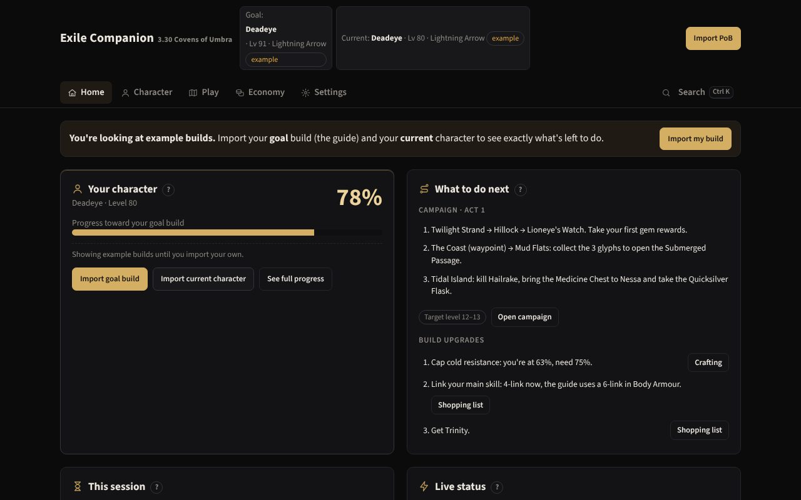
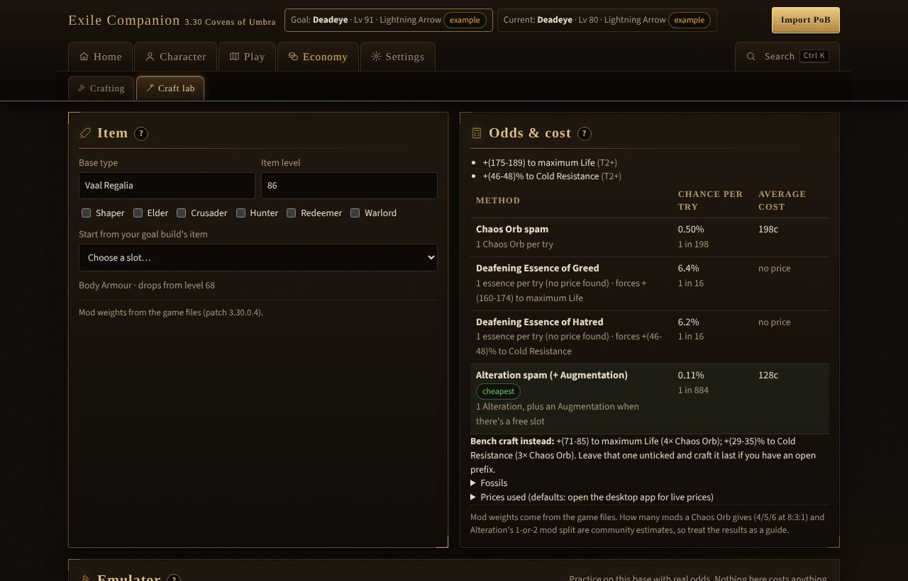

<p align="center"></p>

<h1 align="center">Exile Companion</h1>

<p align="center"><b>A free companion app for Path of Exile 3.30 on Windows.</b><br>
Follow your build guide, level faster, map smarter, price items with Ctrl+C and craft with real odds, all in one place.</p>

<p align="center"><a href="https://github.com/nickolusliquori/exile-companion/releases/latest"><b>Download the latest version</b></a> · <a href="CHANGELOG.md">What's new</a> · <a href="#roadmap">Roadmap</a> · <a href="SECURITY.md">Security</a></p>

---

## What it is for

Path of Exile players usually juggle a dozen tools: Path of Building for the build, a leveling guide, poe.ninja for prices, the trade site, a price-check overlay, Craft of Exile, the wiki, FilterBlade, a stash pricer. Exile Companion brings those jobs into one app that knows your character.

You import the **build guide you're following** (your goal) and **your character as it is now**. From then on the app works out what's left to do and helps with each part of the game:

- **Leveling:** a route for all 10 acts, gem rewards to take, target levels, and act split times.
- **Gearing:** what to buy, what to craft and what's in your stash already, compared with the guide.
- **Mapping:** atlas progression for your build's strength, map mods to avoid, and what each farm earns per hour.
- **Trading:** price checks, net worth, trade whispers and sales tracking.
- **Crafting:** every mod that can roll on a base, the real odds of each method, and a practice emulator.

It reads the game's log file and the clipboard. It **never** presses keys, clicks or reads game memory, so it stays within GGG's one-action-per-key-press rule.

<p align="center"></p>

## Contents

- [Install](#install)
- [First run](#first-run)
- [Features](#features)
- [Hotkeys](#hotkeys)
- [Roadmap](#roadmap)
- [Your data and privacy](#your-data-and-privacy)
- [Troubleshooting](#troubleshooting)
- [For developers](#for-developers)
- [Credits and licence](#credits-and-licence)

## Install

1. Open the [latest release](https://github.com/nickolusliquori/exile-companion/releases/latest) and download **Exile-Companion-Setup-x.y.z.exe**.
2. Run it. Windows SmartScreen warns that the publisher is unknown because the app isn't code-signed: click **More info → Run anyway**.
3. In Path of Exile, set **Options → Graphics → Display mode: Windowed Fullscreen**. True fullscreen hides overlays.

**Updates install themselves.** The app checks this repository's releases when it starts and every 6 hours, downloads updates in the background and installs them when you restart (or press **Restart & update**). Every download is checked against the SHA-512 checksum published with the release. Your builds, progress and settings are kept.

## First run

A two-minute **setup wizard** walks you through:

1. **Your goal build:** paste the Path of Building code or pobb.in link from your guide.
2. **Your current character:** the same, from Path of Building's "Import from website", or skip and use live character sync later.
3. **The game log:** the app finds `Client.txt` for you.
4. **The overlay and price check:** press the overlay hotkey to confirm it works.

You can rerun the wizard any time from **Settings** or with **Ctrl+K → "setup wizard"**.

## Features

The app is organised into five groups along the top. **Ctrl+K** (or **/**) searches every page, card, gear item and action.

### Home

Your character at a glance: progress toward the goal build, what to do next (campaign steps or atlas milestone, plus the biggest build upgrades), session stats, live status (game log, current zone, overlay, trade requests, net worth, updates) and quick actions.

### Character

| Page | What it does |
|---|---|
| **Build** | Your goal build or current character from Path of Building: main skill, DPS, life, ES, resistances and defences, skill groups with gem levels, and every gear item with a game-style tooltip on hover. |
| **Progress** | How close you are to the goal (tree, gear, gems, level), a to-do list ordered by impact, stat comparison, missing passives, gems and gear mods, and the cost to finish with poe.ninja prices. |
| **Shopping list** | Every gem and item to pick up: quest reward, vendor or trade, with copyable vendor searches, trade links, price alerts and a loot filter add-on that highlights your build's bases. |
| **Trees** | GGG's 3.30 passive tree with your passives against the guide (shared, to take, to refund), guide stages, search and hover details. |

### Play

| Page | What it does |
|---|---|
| **Campaign** | A speed route for all 10 acts with gem rewards, target levels, act splits from your log, quest-gem reminders and the answers to `/passives`, `/deaths` and `/played`. |
| **Maps** | Your next atlas step, map mods your build should avoid (with a stash search), map completion from your log, a pinnacle boss checklist and valuable divination cards by map. |
| **Atlas** | Farming strategies that suit your build, how to grow the atlas tree as you get points, and GGG's 3.30 atlas tree with your farm highlighted. |
| **Session** | A play-session timer, maps logged from the game log or by hand, chaos per hour by strategy, session recaps and the game log connection. |

### Economy

| Page | What it does |
|---|---|
| **Crafting** | A crafting plan for each gear slot, crafts that tend to sell for profit, a cost calculator and a 3.30 crafting cheat sheet. |
| **Craft lab** | Mod pools from the game files (patch 3.30.0.4) for any base, item level and influence, with tiers, roll ranges and weights. Tick the mods you want to see the chance and cost of chaos spam, essences, fossils and alteration methods; practise on an **emulator** item; or **simulate** a whole plan 2,000 times for its average and unlucky cost. |
| **Loot filter** | Edit the NeverSink filter you use: show or hide rules, restyle them (size, colours, sound, beam, minimap icon), preview 36 typical drops through it, re-tier currency, cards and uniques with today's poe.ninja prices, and add highlights for your build. Saves a separate `ExileCompanion-…` copy; your original is never changed. |
| **Trading** | A map search builder that hides every tier of the mods you won't run (like poe.re), ready-made vendor searches, a dump-tab pricer that writes `~b/o` notes to copy onto items, a currency flip watcher, and divination card and unique collections. |
| **League** | Built for 3.30's Threads: the cost of the Threads you put in each map (with free Shaped Region Threads and the 8-Thread cap), what each strategy returns for the Threads you spend (from your map log), a Betrayal board with the 3.30 rewards and the moves left to reach your plan, Expedition currency values, and Heist and Labyrinth notes. |
| **Build tools** | Upgrade finder: scores your gear by the stats your build values and finds trade items that beat each slot, ranked by score gained per divine. Timeless jewel lookup and seed finder (Lethal Pride, Brutal Restraint, Militant Faith, Elegant Hubris, Heroic Tragedy) using Path of Building's tables, with a trade search for the seed. Also: cluster jewel notables and their odds for each enchant, gem levelling profit from poe.ninja, and a meta check against poe.ninja's builds page. |
| **Quality of life** | Recent price checks: the last 20 items you copied, each re-checkable with one click (kept in memory only). Session goals (divines, chaos, maps or hours) with progress on Home and the overlay and a notification when reached. The in-app browser pinned over the game in an always-on-top window, with a hotkey and adjustable see-through. |
| **Look and feel** | Three themes (Dark minimal, Modern, Path of Exile), light animations that respect Windows "reduce motion", a loading bar, and minimal synthesized sounds (button clicks, a cue for empty required fields) with volume control. |
| **Media** | A YouTube / YouTube Music / Twitch mini player that stays on top of the game (with click-through), and a Now playing panel for whatever plays in Windows (Spotify, Apple Music, Netflix in a browser…) with play/pause and skip, also on the overlay. |
| **Browser** (desktop) | The trade site, poe.ninja, the wiki, poedb, poelab, Craft of Exile, FilterBlade, poe.re and pobb.in inside the app, signed in, with quick links and a wiki search. Links from the price window and elsewhere open here. Pages are sandboxed away from the app and your saved secrets; other sites open in your own browser. |
| **Account** (desktop) | Live character sync from your GGG profile, stash net worth over time, stash finds (upgrades and items worth selling), currency trends and a sales tracker. |

<p align="center"></p>
<p align="center"></p>

### Settings

General options and your builds, a **hotkey recorder**, your GGG account, Discord status and notifications, updates, backups (plus automatic daily ones), sync with the web version on your phone, the OBS stream overlay, display options (compact mode, ? explainers) and **Report a problem**. **Desktop tools** holds the game log, overlay, price check, trade requests, price alerts, cheat sheets and news.

### In game

- **Overlay:** a see-through panel over the game. In the campaign it shows the act's next steps, gem rewards and XP range; in maps a timer, deaths, your session rate, map-mod search and cards that drop there. Flip pages for build, gear, atlas, session and trades.
- **Price check:** hover an item and press **Ctrl+C**. A window opens by your cursor with poe.ninja values, the cheapest live listings, a mod picker for rares (min and max per mod, tier and roll badges with Ctrl+Alt+C, life and resistance totals), an upgrade check against what you're wearing and a wiki panel. Maps get a "run it or reroll it" verdict.
- **Trade whispers:** buyers show on the overlay with item, price and stash position, and buttons copy `/invite`, `/tradewith` and replies for you to paste.
- **Cheat sheets:** your own images (Betrayal board, Lab layout) shown over the game with a hotkey.

### Everywhere

Notifications (level-up gem and tree reminders, new acts, buyers, milestones), Discord status, a splash screen, compact mode, a phone-friendly web version, undo for removals, and helpful empty states that tell you what to do next.

## Hotkeys

All of these can be changed in **Settings → Hotkeys**.

| Key | What it does |
|---|---|
| **Ctrl+C** (in game, over an item) | Price check (the game copies the item; the app reads the clipboard) |
| **Ctrl+Alt+C** (in game) | Advanced copy: price check plus mod tiers |
| **Ctrl+D** | Re-open the last price check |
| **Ctrl+Shift+O** | Show or hide the overlay |
| **Ctrl+Shift+I** | Overlay click mode: move it, tick steps, press buttons |
| **Ctrl+Shift+P** | Next overlay page |
| **Ctrl+Shift+F** | Copy the overlay's current search, then paste it in game with Ctrl+V |
| **Ctrl+Alt+W** | Open the wiki page of the item you last copied |
| **Ctrl+Shift+H** | Show the next cheat sheet |
| **Ctrl+Shift+M** | Show or hide the media mini player |
| **Ctrl+Shift+B** | Show or hide the browser pinned over the game (Esc hides it too) |
| **Ctrl+K** or **/** (in the app) | Search everything |
| **Esc** | Close the price window or a dialog |

## Roadmap

The loot filter editor shipped in 1.8, the in-app browser in 1.9, the trading tools in 1.10, the League page in 1.11, the build tools in 1.12, the quality-of-life tools in 1.13 and the look-and-feel overhaul in 1.14. Planned releases, in order. Each ships as a regular release through auto-update, gets tested in game afterwards, and any problems found are fixed in a follow-up patch (for example 1.8.1).

| Version | Feature |
|---|---|
| **1.18** | **Data and history:** league data that updates without an app release, a net worth graph and saved trade searches.|

Not planned: anything that sends input to the game (auto-setting stash notes, chat macros) or uploads to your GGG account, because GGG isn't approving new third-party sign-ins.

## Your data and privacy

- **Stays on your PC:** builds, progress, map log, settings and backups. Settings live in `%APPDATA%\exile-companion\config.json`; everything else in the app's own storage.
- **Encrypted:** your POESESSID and any GGG sign-in tokens are encrypted with Windows' data protection, and never included in backups, sync codes or problem reports.
- **Network:** the app itself only talks to `pathofexile.com`, `poe.ninja`, `poewiki.net`, `pobb.in`, `pastebin.com`, item pictures from `web.poecdn.com`, and this repository's releases. The in-app browser loads the sites you open in it, in a separate sandboxed session.
- **Problem reports** are built on your PC, shown to you in full, and only sent if you copy them or open a GitHub issue yourself.

See [SECURITY.md](SECURITY.md) for how the app is protected.

## Troubleshooting

- **Overlay not visible over the game:** switch the game to Windowed Fullscreen. Use **Overlay → Reset position** in the menu if it's off screen.
- **"Client.txt not found":** Settings → Desktop tools → **Find Client.txt** or **Choose file…**, or rerun the setup wizard. It's in the game folder under `logs`.
- **Price check doesn't open:** check Settings → Price check is on, then copy the item again. If it opens once but not on a second Ctrl+C, update to 1.6.1 or later.
- **"Rate-limited" in a price check:** the trade site limits searches; wait the number of seconds shown.
- **A hotkey doesn't work:** another program may be using it. Pick a different one in Settings → Hotkeys.
- **Prices missing for a new league:** set the league name in Settings exactly as the trade site shows it.
- **Anything else:** Settings → **Report a problem** builds a report with the app version, your system and recent errors (no account secrets) that you can copy, save or open as a GitHub issue.

## For developers

The app is an [Electron](https://www.electronjs.org/) app with no frontend framework or build step: plain HTML, CSS and JavaScript.

```
npm install
npm start          # run from source
npm run check      # automated checks (also run on every push)
npm run dist:local # build an installer on your own PC
```

| Path | What it holds |
|---|---|
| `main.js` | Main process: windows, overlay, hotkeys, clipboard watcher, game log, GGG and poe.ninja requests, updater |
| `preload.js` | The small, fixed set of actions pages may call |
| `lib/` | Testable modules: log parsing (`logtail.js`), GGG API (`ggg.js`), Discord (`discord.js`), clipboard watching (`clip.js`), problem-report redaction (`diag.js`) |
| `app/index.html` | The main app: every page, card and the Ctrl+K search |
| `app/craftlab.js`, `app/craftdata.js` | The Craft lab engine and its game data (loaded when the page opens) |
| `app/overlay.html`, `price.html`, `cheat.html`, `stream.html`, `splash.html` | The other windows |
| `scripts/check.js` | Automated checks: syntax, security policy on every page, log parser, repeat price checks, crafting engine, report redaction |
| `scripts/craftdata.py` | Regenerates `app/craftdata.js` from a [RePoE](https://repoe-fork.github.io) export after a patch |

**Releasing:** bump `version` in `package.json` and push to `main`. GitHub Actions runs the checks, builds the Windows installer and publishes the release with notes from [CHANGELOG.md](CHANGELOG.md); installed apps update themselves. A version with a suffix such as `1.8.0-beta.1` is published as a pre-release, which auto-update ignores. See [CONTRIBUTING.md](CONTRIBUTING.md) for more.

**Updating map-mod data after a patch:** run `python3 scripts/mapmods.py <folder> <patch version>` with the same export (it needs `mods.json` and `base_items.json`).

**Updating crafting data after a patch:** download `mods.json`, `base_items.json`, `essences.json`, `fossils.json`, `crafting_bench_options.json` and `item_classes.json` from the RePoE export, then run `python3 scripts/craftdata.py <folder> <patch version>`.

## Credits and licence

Exile Companion is free and open source under the [MIT License](LICENSE).

- Passive and atlas tree data: GGG's official [skilltree-export](https://github.com/grindinggear/skilltree-export) and [atlastree-export](https://github.com/grindinggear/atlastree-export).
- Gem, quest-reward and area data: [exile-leveling](https://github.com/HeartofPhos/exile-leveling) by HeartofPhos (MIT).
- Crafting data: the [RePoE](https://github.com/repoe-fork/repoe) export of the game files (MIT).
- Prices: [poe.ninja](https://poe.ninja) and the [official trade site](https://www.pathofexile.com/trade). Item details and divination card drops: the [Path of Exile wiki](https://www.poewiki.net).

Full licence texts are in [THIRD_PARTY_NOTICES.md](THIRD_PARTY_NOTICES.md). This is a fan-made tool, not affiliated with or endorsed by Grinding Gear Games. Path of Exile is a trademark of Grinding Gear Games.
