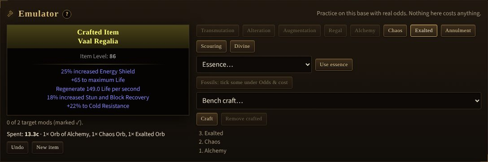

<p align="center"></p>

<h1 align="center">Exile Companion</h1>

<p align="center"><b>A free companion app for Path of Exile 3.30 on Windows.</b><br>
Follow your build guide, level faster, map smarter, price-check and trade, craft with real odds and edit your loot filter, all in one place.</p>

<p align="center"><a href="https://github.com/nickolusliquori/exile-companion/releases/latest"><b>Download the latest version</b></a> · <a href="CHANGELOG.md">What's new</a> · <a href="#how-it-follows-gggs-rules">GGG rules</a> · <a href="#roadmap">Roadmap</a> · <a href="SECURITY.md">Security</a></p>

<p align="center"><i>This product isn't affiliated with or endorsed by Grinding Gear Games in any way.</i></p>

---

## What it is for

Path of Exile players usually juggle a dozen tools: Path of Building for the build, a leveling guide, poe.ninja for prices, the trade site, a price-check overlay such as Awakened PoE Trade, Craft of Exile, FilterBlade, the wiki, a stash pricer and a trade-whisper helper. Exile Companion brings those jobs into one free app that knows your character.

You import the **build guide you're following** (your goal) and **your character as it is now**. From then on the app works out what's left to do and helps with each part of the game:

- **Leveling:** a route for all 10 acts, gem rewards to take, target levels and act split times, on an in-game overlay.
- **Gearing:** what to buy, what to craft and what's already in your stash, plus an **upgrade finder** that searches the trade site for the best upgrade per divine.
- **Price checking:** press Ctrl+C on an item, then Ctrl+D. A price window shows poe.ninja values and live listings with similar mods, mod tiers, a map check where you mark dangerous mods, and an upgrade check against your gear.
- **Trading:** trade whispers with copy-paste replies, your own purchases, saved trade searches, a dump-tab pricer, net worth over time and sales tracking.
- **Mapping and league content:** atlas strategies for your build, Thread costs per map, a 3.30 Betrayal board, Expedition values and a chaos/regal recipe tracker.
- **Crafting and build tools:** every mod that can roll on a base with real odds, an emulator and simulator, timeless and cluster jewel helpers and gem levelling profit.
- **Loot filter:** a FilterBlade-style editor for your NeverSink filter.
- **Extras:** an in-app browser (also pinnable over the game), a YouTube/Twitch mini player, "now playing" controls, three themes and a phone-friendly web version.

The app **reads** your game log and, only when you press a hotkey, the clipboard. It **never** presses keys, clicks, reads game memory or touches game files. See [How it follows GGG's rules](#how-it-follows-gggs-rules).

<p align="center"></p>

## Contents

- [Install](#install)
- [First run](#first-run)
- [Features](#features)
- [Hotkeys](#hotkeys)
- [How it follows GGG's rules](#how-it-follows-gggs-rules)
- [Roadmap](#roadmap)
- [Your data and privacy](#your-data-and-privacy)
- [Troubleshooting](#troubleshooting)
- [For developers](#for-developers)
- [Credits and licence](#credits-and-licence)

## Install

1. Open the [latest release](https://github.com/nickolusliquori/exile-companion/releases/latest) and download **Exile-Companion-Setup-x.y.z.exe**.
2. Run it. Windows SmartScreen warns that the publisher is unknown because the app isn't code-signed: click **More info → Run anyway**.
3. In Path of Exile, set **Options → Graphics → Display mode: Windowed Fullscreen**. True fullscreen hides overlays.

**Updates install themselves.** The app checks this repository's releases when it starts and every 6 hours, downloads updates in the background and installs them when you restart (or press **Restart & update**). Every download is checked against the SHA-512 checksum published with the release. Your builds, progress and settings are kept.

## First run

A two-minute **setup wizard** walks you through:

1. **Your goal build:** paste the Path of Building code or pobb.in link from your guide.
2. **Your current character:** the same, from Path of Building's "Import from website", or skip and use live character sync later.
3. **The game log:** the app finds `Client.txt` for you.
4. **The overlay and price check:** press the overlay hotkey to confirm it works, then try a price check (Ctrl+C on an item, then Ctrl+D).

No build yet? The first step links to guide sites (Maxroll, Mobalytics, poe.ninja) and explains where to find the Path of Building code, or you can choose **Just leveling for now**: the campaign route, overlay, price checks and maps all work without a build.

New installs start in **starter mode**, which shows only the main pages (Home, Build, Progress, Campaign, Maps, Session and Settings). Any page you open from Ctrl+K unlocks itself, and **＋ All pages** in the top bar (or Settings → Look and feel) shows everything. Updating from an older version keeps all pages showing.

The wizard ends with an optional **1-minute tour** that points out the sections, search and the Home cards. The first time you enter a zone, and the first time you enter a map, the overlay shows a one-line hint with the relevant hotkeys. Replay the tour or reset the hints in Settings → Look and feel.

You can rerun the wizard any time from **Settings** or with **Ctrl+K → "setup wizard"**.

## Features

The app is organised into five groups along the top. **Ctrl+K** (or **/**) searches every page, card, gear item and action.

### Home

Your character at a glance: progress toward the goal build, what to do next (campaign steps or atlas milestone, plus the biggest build upgrades), session stats, live status (game log, current zone, overlay, trade requests, net worth, updates) and quick actions.

### Character

| Page | What it does |
|---|---|
| **Build** | Your goal build or current character from Path of Building: main skill, DPS, life, ES, resistances and defences, skill groups with gem levels, and every gear item with a game-style tooltip on hover. |
| **Progress** | How close you are to the goal (tree, gear, gems, level), a to-do list ordered by impact, stat comparison, missing passives, gems and gear mods, and the cost to finish with poe.ninja prices. |
| **Shopping list** | Every gem and item to pick up: quest reward, vendor or trade, with copyable vendor searches, trade links, price alerts and a loot filter add-on that highlights your build's bases. |
| **Trees** | GGG's 3.30 passive tree with your passives against the guide (shared, to take, to refund), guide stages, search and hover details. |
| **Build tools** | **Upgrade finder** (scores each gear slot by the stats your build values and searches the trade site for the best upgrade per divine), **timeless jewel** lookup and seed finder (Lethal Pride, Brutal Restraint, Militant Faith, Elegant Hubris, Heroic Tragedy) from Path of Building's tables, **cluster jewel** notables and their odds per enchant, **gem levelling profit**, and a meta check against poe.ninja's builds page. |

### Play

| Page | What it does |
|---|---|
| **Campaign** | A speed route for all 10 acts with gem rewards, target levels, act splits from your log, quest-gem reminders and the answers to `/passives`, `/deaths` and `/played`. |
| **Maps** | Your next atlas step, map mods your build should avoid (with a stash search), map completion from your log, a pinnacle boss checklist and valuable divination cards by map. |
| **Atlas** | Farming strategies that suit your build, how to grow the atlas tree as you get points, and GGG's 3.30 atlas tree with your farm highlighted. |
| **Session** | A play-session timer, maps logged from the game log or by hand, chaos per hour by strategy, **session goals** (divines, chaos, maps or hours) with progress on Home and the overlay, session recaps and the game log connection. |
| **League** | Built for 3.30's Threads: the cost of the Threads you put in each map (free Shaped Region Threads, the 8-Thread cap), what each strategy returns for the Threads you spend, a Betrayal board with 3.30 rewards and the moves left to reach your plan, Expedition currency values, and Heist and Labyrinth notes. League data can be corrected between releases from this repository. |

### Economy

| Page | What it does |
|---|---|
| **Crafting** | A crafting plan for each gear slot, crafts that tend to sell for profit, a cost calculator and a 3.30 crafting cheat sheet. |
| **Craft lab** | Mod pools from the game files (patch 3.30.0.4) for any base, item level and influence, with tiers, roll ranges and weights. Tick the mods you want to see the chance and cost of chaos spam, essences, fossils and alteration methods; practise on an **emulator** item; or **simulate** a whole plan 2,000 times for its average and unlucky cost. |
| **Loot filter** | Edit the NeverSink filter you use: show or hide rules, restyle them (size, colours, sound, beam, minimap icon), preview 36 typical drops through it, re-tier currency, cards and uniques with today's poe.ninja prices, and add highlights for your build. Saves a separate `ExileCompanion-…` copy; your original is never changed. |
| **Trading** | Saved trade searches and recent search history (from the in-app browser), a map search builder that hides every tier of the mods you won't run (like poe.re), ready-made vendor searches, a dump-tab pricer that writes `~b/o` notes to copy onto items, a currency flip watcher, and divination card and unique collections. |
| **Browser** (desktop) | The trade site, poe.ninja, the wiki, poedb, poelab, Craft of Exile, FilterBlade, poe.re and pobb.in inside the app, signed in, with quick links and a wiki search. Links from the price window and elsewhere open here. Pages are sandboxed away from the app and your saved secrets; other sites open in your own browser. |
| **Account** (desktop) | Live character sync from your GGG profile, stash net worth over time (24 h / 7 days / all, in divines or chaos), a **chaos/regal recipe tracker**, stash finds (upgrades and items worth selling), currency trends and a sales tracker. |

<p align="center"></p>
<p align="center"></p>

### Settings

General options and your builds, a **hotkey recorder**, **Look and feel** (three themes: Dark minimal, Modern and Path of Exile; animations that respect Windows "reduce motion"; minimal sounds with a volume slider; **text size** from 90% to 150% with Ctrl + plus / minus / 0; **higher contrast**; **colorblind-friendly colors** that also apply to the overlay and price check; starter mode and the tour), your GGG account, Discord status and notifications, updates, backups (plus automatic daily ones), sync with the web version on your phone, the OBS stream overlay, display options and **Report a problem**.

- **Desktop tools:** the game log, overlay, price check, trade requests, price alerts, cheat sheets and recent price checks.
- **Media:** a YouTube / YouTube Music / Twitch / Kick / SoundCloud **mini player** that stays on top of the game (with click-through, volume and see-through), and **Now playing** controls for whatever plays in Windows (Spotify, Apple Music, Netflix or YouTube in your browser, Stremio…). Netflix, Hulu, Disney+, Apple Music and similar can't play inside the app because they need copy protection (Widevine) it doesn't have.

### In game

- **Overlay:** a see-through panel over the game. In the campaign it shows the act's next steps, gem rewards and XP range; in maps a timer, deaths, your session rate, map-mod search and cards that drop there. Flip pages for build, gear, atlas, session, trades and **Tools** (saved stash searches to copy, a stopwatch and notes).
- **Price check:** hover an item, press **Ctrl+C** (the game's copy), then **Ctrl+D**. A window opens by your cursor with poe.ninja values and the cheapest live listings. Rares and magic items search for items with **similar prefixes and suffixes** (min and max per mod, "at least N of" or "all", tier and roll badges when you copy with Ctrl+Alt+C, life and resistance totals). Maps get a **map check**: click any mod to mark it as a warning or danger for every map. Plus an upgrade check against what you wear, and **Wiki**, **poedb** and **Craft lab** buttons.
- **Trade companion:** incoming whispers show with item, price, stash position and a poe.ninja price hint; whispers you send show under "You're buying". Buttons copy `/invite`, `/tradewith`, `/hideout` and your own quick replies for you to paste. Buyers arriving trigger a notification.
- **Browser over the game:** the in-app browser in an always-on-top window (Ctrl+Shift+B), sharing your trade-site sign-in.
- **Cheat sheets:** your own images (Betrayal board, Lab layout) shown over the game with a hotkey.

### Everywhere

Notifications (level-up gem and tree reminders, new acts, buyers, goals, milestones), Discord status, a loading bar, a phone-friendly web version, undo for removals, Ctrl+K search, and empty states that tell you what to do next.
- **Keyboard and screen readers:** a skip link, arrow keys between sections and pages, labelled fields and buttons, and announced notices.

## Hotkeys

All of these can be changed in **Settings → Hotkeys**.

| Key | What it does |
|---|---|
| **Ctrl+C**, then **Ctrl+D** | Price check: the game copies the item (Ctrl+C), the app reads the clipboard once (Ctrl+D) |
| **Ctrl+Alt+C**, then **Ctrl+D** | Price check with mod tiers and rolls (the game's advanced copy) |
| **Ctrl+Shift+O** | Show or hide the overlay |
| **Ctrl+Shift+I** | Overlay click mode: move it, tick steps, press buttons |
| **Ctrl+Shift+P** | Next overlay page |
| **Ctrl+Shift+F** | Copy the overlay's current search, then paste it in game with Ctrl+V |
| **Ctrl+Alt+W** | Open the wiki page of the item you last copied |
| **Ctrl+Shift+H** | Show the next cheat sheet |
| **Ctrl+Shift+Space** | Overlay Tools page: stash searches to copy, a stopwatch and notes (click mode) |
| **Ctrl+Shift+M** | Show or hide the media mini player |
| **Ctrl+Shift+B** | Show or hide the browser pinned over the game (Esc hides it too) |
| **Ctrl+K** or **/** (in the app) | Search everything |
| **Esc** | Close the price window or a dialog |

## How it follows GGG's rules

Exile Companion is built to stay inside Grinding Gear Games' [Terms of Use](https://www.pathofexile.com/legal/terms-of-use-and-privacy-policy) and [developer guidelines](https://www.pathofexile.com/developer/docs). In short:

| GGG's rule | What the app does |
|---|---|
| Apps must not interact with the game or its files. | It never sends key presses, clicks or chat to the game, never reads or changes game memory, and never modifies game files. Its overlays (overlay, price window, pinned browser, media player) are ordinary windows shown on top of the game. |
| Macros must be manually invoked and do one thing. | Every hotkey does one thing inside the app itself (show the overlay, open a price check, copy a search). Nothing runs on timers, file changes or screen reading to act in the game. |
| Screen, clipboard or log data may be read only if the user knows, and the clipboard only once per manual key press. | It reads `Client.txt` (the game's log), which setup explains and you can turn off. It reads the clipboard **once each time you press the price hotkey** and never watches it in the background (the old automatic mode was removed in 1.22). It never reads the screen. |
| Follow the API rate limits. | Requests read GGG's `X-Rate-Limit-*` and `Retry-After` headers and wait before a limit is reached; trade searches are queued and paced. Every request identifies the app with a User-Agent. |
| Keep credentials safe; don't embed keys in code or binaries. | No client IDs, secrets or keys ship in this repository or the installer. Your POESESSID or sign-in tokens are encrypted on your PC with Windows' data protection and never leave it. |
| Respect players' privacy. | Everything stays on your PC. Nothing is uploaded, and there are no analytics. Problem reports are shown to you in full and only shared if you choose to. |
| Don't imply GGG endorsement or use GGG logos; no commercial use of GGG's IP. | Free and open source with no ads, paid features or donations. No GGG logos. The app and this page carry GGG's disclaimer. |

**Accounts and data sources:**

- **Live character sync** uses GGG's public character pages (the same ones Path of Building reads).
- **Stash features** (net worth, recipes, dump-tab pricer) use your **POESESSID** cookie with the website's stash pages, as Path of Building and other long-standing tools do. That's optional and stays on your PC. GGG's documented **OAuth API** is the better way: it lets you sign in with your GGG account and grant only the access the app needs. The app already supports it (a public client with PKCE and a local redirect, as GGG's docs require for desktop apps) and is waiting on a client ID. GGG's developer page currently says it can't process new applications.
- **Price checks** use the official trade site's search, like other price-check tools. That isn't part of GGG's documented developer API, so the app paces it to the published limits.
- **Prices** come from poe.ninja's public economy API.

If GGG asks for any change, it will be made. Contact: open an issue on this repository.

## Roadmap

Shipped so far: the loot filter editor (1.8), in-app browser (1.9), trading tools (1.10), League page (1.11), build tools (1.12), quality of life (1.13), themes and motion (1.14), upgrade finder (1.15), deeper price checks (1.16), media (1.17), league data updates and saved searches (1.18), map marks and item links (1.19), trade companion and recipe tracker (1.20), overlay tools (1.21), the clipboard-rule update (1.22), new-league handling (1.23), an automatic game data pipeline (1.24), the first-time experience (1.25), crash recovery with safe mode (1.26) and accessibility options (1.27). Every release ships through auto-update and gets tested in game afterwards; problems found are fixed in a follow-up patch. See the [changelog](CHANGELOG.md) for details.

| Version | Feature |
|---|---|
| Pending GGG | **Sign in with your GGG account (OAuth)** to replace the POESESSID, and upload edited loot filters straight to your account, once GGG issues a client ID. |
| Next | Ideas welcome: open a feature request on GitHub or use Settings → Report a problem.|

Not planned: anything that sends input to the game (auto-typed whispers, chat macros, auto-setting stash notes), reads game memory, or watches the screen or clipboard in the background.

## Your data and privacy

- **Stays on your PC:** builds, progress, map log, settings and backups. Settings live in `%APPDATA%\exile-companion\config.json`; everything else in the app's own storage.
- **Encrypted:** your POESESSID and any GGG sign-in tokens are encrypted with Windows' data protection, and never included in backups, sync codes or problem reports.
- **New leagues:** the app checks GGG's trade league list to follow league launches, and this repository's `data/` folder for game and league data updates.
- **Network:** the app itself only talks to `pathofexile.com`, `poe.ninja`, `poewiki.net`, `pobb.in`, `pastebin.com`, item pictures from `web.poecdn.com`, this repository's releases, and this repository's `data/` folder for league data. The in-app browser and the media player load the sites you open in them, each in its own sandboxed session.
- **Windows media controls:** "Now playing" asks Windows what's playing and can play, pause or skip. You can turn it off on the Media page.
- **Log:** errors, crashes and startup times go to `%APPDATA%\exile-companion\logs\app.log` (two files of 512 KB at most). Your user name, session ids, tokens and e-mail addresses are removed as it's written. It's only shared if you save a problem report.
- **Problem reports** are built on your PC, shown to you in full, and only sent if you copy them or open a GitHub issue yourself.

See [SECURITY.md](SECURITY.md) for how the app is protected.

## Troubleshooting

- **Overlay not visible over the game:** switch the game to Windowed Fullscreen. Use **Overlay → Reset position** in the menu if it's off screen.
- **"Client.txt not found":** Settings → Desktop tools → **Find Client.txt** or **Choose file…**, or rerun the setup wizard. It's in the game folder under `logs`.
- **Price check doesn't open:** press **Ctrl+C** over the item in game, then **Ctrl+D** (or the hotkey you set). Since 1.22 the app no longer opens price checks on Ctrl+C alone, to follow GGG's clipboard rule.
- **"Rate-limited" in a price check:** the trade site limits searches; wait the number of seconds shown.
- **A hotkey doesn't work:** another program may be using it. Pick a different one in Settings → Hotkeys.
- **Prices missing for a new league:** set the league name in Settings exactly as the trade site shows it.
- **The app crashes or won't start:** if it fails to finish starting twice in a row, it starts in **safe mode** next time: no overlay, price window, hotkeys, media, Discord or graphics acceleration. If safe mode works, the cause is likely one of those, often the graphics driver. You can also choose Settings → **Restart in safe mode**. A window that crashes is reloaded automatically.
- **Anything else:** Settings → **Report a problem** builds a report with the app version, your system, recent errors and the last lines of the log (no account secrets) that you can copy, save or open as a GitHub issue.

## For developers

The app is an [Electron](https://www.electronjs.org/) app with no frontend framework or build step: plain HTML, CSS and JavaScript.

```
npm install
npm start          # run from source
npm run check      # automated checks (also run on every push)
npm run dist:local # build an installer on your own PC
```

| Path | What it holds |
|---|---|
| `main.js` | Main process: windows, overlay, price window, pinned browser, media player, hotkeys, game log, GGG and poe.ninja requests (rate-limited), updater |
| `preload.js` | The small, fixed set of actions pages may call |
| `lib/` | Testable modules: log parsing (`logtail.js`), GGG API and OAuth (`ggg.js`), trade rate limiter (`ratelimit.js`), allowed sites (`webhosts.js`), Windows media controls (`media.js`), Discord (`discord.js`), clipboard helpers (`clip.js`), filter file names (`files.js`), problem-report redaction (`diag.js`) |
| `app/index.html` | The main app: every page, card and the Ctrl+K search |
| `app/craftlab.js`, `app/craftdata.js` | The Craft lab engine and its game data (loaded when the page opens) |
| `app/filterlab.js`, `tradetools.js`, `league.js`, `buildtools.js`, `upgrades.js` | Loot filter editor, trading tools, League page, build tools and upgrade finder (each loaded when its page opens) |
| `app/timelessdata.js`, `clusterdata.js`, `mapmods.js`, `treedata.js`, `atlasdata.js` | Generated game data |
| `app/theme.css` | Themes, motion and loading styles |
| `data/league.json` | League data the app can refresh between releases (see [data/README.md](data/README.md)) |
| `app/overlay.html`, `price.html`, `pin.html`, `media.html`, `cheat.html`, `stream.html`, `splash.html` | The other windows |
| `scripts/check.js` | Automated checks: syntax, security policy on every page, GGG guideline checks, log parser, rate limiter, crafting engine, timeless tables, league data, report redaction and more |
| `scripts/craftdata.py`, `mapmods.py` | Regenerate crafting and map-mod data from a [RePoE](https://repoe-fork.github.io) export after a patch |
| `scripts/timeless.py`, `clusters.py` | Regenerate timeless and cluster jewel data from a Path of Building checkout |

**Releasing:** bump `version` in `package.json` and push to `main`. GitHub Actions runs the checks, builds the Windows installer and publishes the release with notes from [CHANGELOG.md](CHANGELOG.md); installed apps update themselves. A version with a suffix such as `1.8.0-beta.1` is published as a pre-release, which auto-update ignores. See [CONTRIBUTING.md](CONTRIBUTING.md) for more.

**Keeping game data current:** a weekly GitHub Actions job ([data-update.yml](.github/workflows/data-update.yml), Mondays, or run it by hand from the Actions tab) fetches GGG's tree exports, the RePoE export and Path of Building's data, regenerates the data files, runs the checks and opens a pull request when something changed. It flags a new patch and lists what to review. Merge it, then bump the version to ship. Run the same thing locally with `scripts/update-data.sh`. What was used is recorded in `data/sources.json`. For the pull request step, allow it under **Settings → Actions → General → Workflow permissions → "Allow GitHub Actions to create and approve pull requests"**; otherwise the job opens an issue with a link instead.

Individual generators, if you need one: `scripts/trees.py` (passive and atlas trees), `scripts/craftdata.py` and `scripts/mapmods.py` (RePoE), `scripts/timeless.py` and `scripts/clusters.py` (Path of Building), `scripts/export-game.js` (data/game.json from the built-in tables).

## Credits and licence

Exile Companion is free and open source under the [MIT License](LICENSE).

- Passive and atlas tree data: GGG's official [skilltree-export](https://github.com/grindinggear/skilltree-export) and [atlastree-export](https://github.com/grindinggear/atlastree-export).
- Gem, quest-reward and area data: [exile-leveling](https://github.com/HeartofPhos/exile-leveling) by HeartofPhos (MIT).
- Crafting data: the [RePoE](https://github.com/repoe-fork/repoe) export of the game files (MIT).
- Timeless and cluster jewel data: [Path of Building Community](https://github.com/PathOfBuildingCommunity/PathOfBuilding) (MIT).
- Prices: [poe.ninja](https://poe.ninja) and the [official trade site](https://www.pathofexile.com/trade). Item details and divination card drops: the [Path of Exile wiki](https://www.poewiki.net).

Full licence texts are in [THIRD_PARTY_NOTICES.md](THIRD_PARTY_NOTICES.md). This product isn't affiliated with or endorsed by Grinding Gear Games in any way. Path of Exile is a trademark of Grinding Gear Games.
